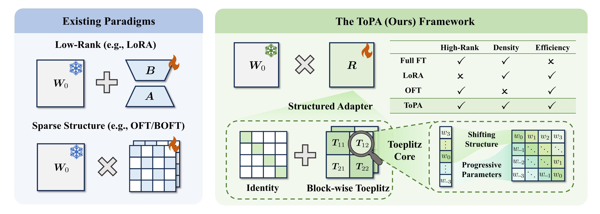

# ToPA

Official implementation of **ToPA: Block-wise Toeplitz Adaptation for Expressive and Efficient Fine-Tuning** (**NeurIPS 2026**).

**Paper Title: ToPA: Block-wise Toeplitz Adaptation for Expressive and Efficient Fine-Tuning.**

**Authors: Sicong Li, [Qianqian Xu\*](https://qianqianxu010.github.io/), [Zhiyong Yang](https://joshuaas.github.io/), [Zitai Wang](https://wang22ti.com/), Longtao Huang, [Xiaochun Cao](https://scst.sysu.edu.cn/members/1401493.htm), [Qingming Huang\*](https://people.ucas.ac.cn/~qmhuang)**

> **Abstract:** Parameter-Efficient Fine-Tuning (PEFT) has emerged as a prevalent strategy for adapting large pre-trained models. Among PEFT techniques, reparameterization-based methods, particularly those that employ low-rank or sparsity structures, have attracted significant attention. However, these approaches often underperform full fine-tuning. Specifically, low-rank methods constrain the update rank, which is misaligned with the inherently high-rank nature of full fine-tuning. In contrast, sparsity-based techniques limit the flexibility of the parameter space and compromise connectivity across weights. To overcome these limitations, we explore the use of Toeplitz matrices, whose entries are constant along each diagonal, therefore providing a compact parameterization without imposing explicit rank or sparsity constraints. A straightforward approach is to update weights via a product of Toeplitz matrices. However, similar to RNNs, long multiplicative chains often lead to gradient instability. To address this issue, we propose ToPA, a more refined version of this idea that replaces standard Toeplitz matrices with block-wise Toeplitz, greatly increasing each factor's capacity and shortening the chain, thereby stabilizing training and improving expressiveness. We theoretically show that products of block-wise Toeplitz matrices can approximate arbitrary matrices under shorter chain length, justifying the structural design of ToPA. Furthermore, we demonstrate that ToPA offers greater expressivity than existing low-rank and sparse parameterizations. Empirical evaluations across 21 NLP and CV datasets, spanning 5 model architectures, consistently validate the effectiveness of ToPA.




## Installation

Use Python 3.10 or later and install a PyTorch build compatible with your CUDA
environment, then install the dependencies:

```bash
pip install -r requirements.txt
```


## Datasets

Download the prepared datasets from [PiSSA on Hugging Face](https://huggingface.co/datasets/fxmeng/pissa-dataset).
Place the `commonsense`, `metamath`, and `python` directories under `pissa-dataset/`
in the repository root, using the following layout:

```text
pissa-dataset/
├── commonsense/
│   ├── train.json
│   └── test.json
├── metamath/
│   ├── train.json
│   └── test.json
└── python/
    ├── train.json
    └── test.json
```

| Task | Training data | Evaluation |
| --- | --- | --- |
| `commonsense` | Commonsense170K | Eight commonsense benchmarks |
| `metamath` | MetaMathQA | GSM8K and MATH |
| `python` | Python subset of CodeFeedback | HumanEval and MBPP |


## Scripts

Training and evaluation launchers are provided in [scripts/](scripts/), grouped
by task and backbone. For example:

```bash
# Mathematical reasoning
bash scripts/metamath/train_topa.sh

# Commonsense reasoning
bash scripts/commonsense/train_topa.sh

# Code generation
bash scripts/python/train_topa.sh
```


### Using ToPA in Python

ToPA is implemented in [peft/tuners/topa/](peft/tuners/topa/). The local PEFT
0.14.0 package retains the original tuners and adds `ToPAConfig` and `ToPAModel`.

```python
from peft import TaskType, ToPAConfig, get_peft_model

config = ToPAConfig(
    task_type=TaskType.CAUSAL_LM,
    target_modules=["q_proj", "v_proj"],
    toep_r=3,
    block_size=512,
)
model = get_peft_model(base_model, config)
```

- `toep_r` is the Toeplitz factor chain length.
- `block_size` is the size of each Toeplitz block and must divide the input width.
  For input width `n`, the number of blocks per dimension is `n / block_size`.

Saved adapters use `peft_type="TOPA"` and the `topa_` weight prefix. Adapters saved
before this rename need their configuration and weight keys converted before
loading with this version.


## Citation

If ToPA is useful for your research, please cite our paper:

```bibtex
@inproceedings{li2026topa,
  title={ToPA: Block-wise Toeplitz Adaptation for Expressive and Efficient Fine-Tuning},
  author={Sicong Li and Qianqian Xu and Zhiyong Yang and Zitai Wang and Longtao Huang and Xiaochun Cao and Qingming Huang},
  booktitle={Advances in Neural Information Processing Systems},
  year={2026}
}
```

## Acknowledgements

The training and evaluation pipeline is based on
[PiSSA](https://github.com/GraphPKU/PiSSA), and the adapter infrastructure is based
on [Hugging Face PEFT](https://github.com/huggingface/peft).
Dataset provenance is documented on the [PiSSA dataset page](https://huggingface.co/datasets/fxmeng/pissa-dataset).
